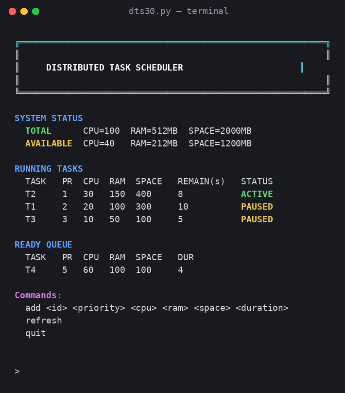

<div align="center">

# ⚙️ Distributed Task Scheduler

**A terminal-based, resource-aware, preemptive priority scheduler simulation written in Python**

🎓 Mini Lab Project · Department of CSE · Daffodil International University (DIU)



<sub>Live dashboard: T2 preempted T1, T3 is waiting behind it, and T4 is in the ready queue.</sub>

</div>

---

## 📖 Overview

Every operating system has to decide **which task runs next** when many tasks compete for limited CPU, memory, and disk space. This project is a small simulation of exactly that decision-making process.

You type tasks into a command prompt, each with a priority, a resource requirement, and a duration. The scheduler then decides, second by second, which task is active, which are paused, and which must wait in the ready queue, while a live dashboard shows everything happening in the terminal.

---

## ✨ Features

| | Feature | Description |
|---|---|---|
| 🖥️ | **Interactive CLI** | Add tasks and watch the system react live |
| 📊 | **Live dashboard** | Total vs. available CPU, RAM and storage, running tasks, and the ready queue |
| ⏫ | **Preemptive priority scheduling** | A higher-priority task can pause the currently active one |
| 🧠 | **Resource-aware admission** | A task is admitted only if enough CPU, RAM and storage are free; otherwise it waits in the ready queue |
| 🔁 | **Background "tick" thread** | Counts down the active task every second and automatically starts queued tasks when resources are released |
| 🔒 | **Thread-safe state** | A lock protects shared data between the UI thread and the timer thread |
| 🎨 | **Colorful output** | ANSI colors make the dashboard easy to read |

---

## 🛠️ Built With

- **Python 3** (standard library only)
- `threading` runs the CLI and the countdown timer concurrently
- `heapq` keeps the ready queue ordered by priority
- `os` and `time` handle screen refresh and timing

**OS concepts demonstrated:** preemptive priority scheduling · resource allocation · ready queue management · concurrency and synchronization

---

## 📋 Requirements

- Python **3.6 or newer**
- No external packages, nothing to `pip install`

Check your version:

```bash
python3 --version
```

---

## ▶️ Getting Started

```bash
# 1. Clone the repository
git clone https://github.com/Noon131/Distributed-Task-Scheduler.git
cd Distributed-Task-Scheduler

# 2. Run the scheduler
python3 dts30.py
```

The dashboard appears with a `>` prompt where you can enter commands.

> 💡 On Windows, use `python dts30.py` if `python3` is not recognized.

---

## 💻 Commands

| Command | Description |
|---|---|
| `add <id> <priority> <cpu> <ram> <space> <duration>` | Submit a new task to the scheduler |
| `refresh` | Redraw the dashboard to see updated countdowns |
| `quit` | Stop the scheduler and exit |

### Task parameters

| Field | Meaning | System limit |
|---|---|---|
| `id` | A label for the task, e.g. `T1` | n/a |
| `priority` | **Lower number = higher priority** (1 beats 5) | n/a |
| `cpu` | CPU units required | 100 total |
| `ram` | RAM required, in MB | 512 MB total |
| `space` | Storage required, in MB | 2000 MB total |
| `duration` | Run time in seconds | n/a |

---

## 🧪 Example Walkthrough

```text
> add T1 2 20 100 300 10
> add T2 1 30 150 400 8
> add T3 3 10 50 100 5
> add T4 5 60 100 100 4
```

| Step | What happens |
|---|---|
| `T1` | Nothing else is running, so T1 starts immediately and becomes **ACTIVE**. |
| `T2` | Priority 1 beats priority 2 and enough resources are free, so T2 **preempts** T1. T1 becomes **PAUSED** and T2 becomes **ACTIVE**. |
| `T3` | Lower priority than both, so it does not preempt. Enough resources are free, so it is admitted and waits as **PAUSED** behind T1. |
| `T4` | It needs 60 CPU but only 40 are free, so it goes to the **Ready Queue**. |
| T2 finishes | Its resources are released, T4 now fits and is admitted from the ready queue, and T1 (the highest-priority remaining task) resumes as **ACTIVE**. |

Type `refresh` at any time to see the current countdowns.

---

## 🧠 How It Works

### System resources
The scheduler manages a fixed pool of **100 CPU units, 512 MB RAM, and 2000 MB storage**.

### When a new task arrives

```text
New task
   │
   ├─ Nothing running? ──► Enough resources? ── yes ─► Start it
   │                                          └─ no ──► Ready Queue
   │
   └─ Something running?
         │
         ├─ Higher priority (or same priority with less remaining time)?
         │      ├─ Enough free resources ─► PREEMPT: pause current task, run new one
         │      └─ Not enough resources ──► Ready Queue
         │
         └─ Otherwise
                ├─ Enough free resources ─► Admit (waits its turn, paused)
                └─ Not enough resources ──► Ready Queue
```

### The ordering rule
Admitted tasks are sorted by **priority first, then remaining time** (shortest first). Only the task at the top of that order is **ACTIVE**; all others are **PAUSED**.

### The background tick
A separate thread wakes up every second and:
1. Reduces the remaining time of the active task by the elapsed time.
2. When the task finishes, releases its CPU, RAM and storage back to the pool.
3. Activates the next task in order.
4. Pulls waiting tasks out of the ready queue if they now fit.

> ℹ️ Resources stay reserved for a paused task until it finishes, just like memory stays allocated to a suspended process.

---

## 📁 Project Structure

```text
.
├── dts30.py                       # Main scheduler program
├── DTS_Final_Project_Report.pdf   # Full project report
├── docs/
│   └── dashboard.png              # Dashboard screenshot used in this README
└── README.md                      # Project documentation
```

---

## 🚧 Known Limitations

- It is a **simulation**: it does not control real hardware or real OS processes.
- It runs on a **single machine** and is not distributed across physical nodes yet.
- It has a **command-line interface only** (no GUI).
- There is **no aging mechanism**, so a continuous stream of high-priority tasks can starve low-priority ones.

---

## 🔮 Future Improvements

- [ ] Graphical User Interface (GUI)
- [ ] Real-time charts for resource usage
- [ ] True network-based scheduling across multiple machines
- [ ] Task logging, history, and reports
- [ ] Aging to prevent starvation of low-priority tasks
- [ ] Input validation for the `add` command

---

## 👥 Authors

Created by the team below as a mini lab project for **CSE324: Operating System Lab**.

| Name |
|---|
| **Mubas Sera Noon** |
| **Md. Ibna Labid** |
| **Md Rizwan Karim Lam** |
| **Md Ahsanur Rahman Nakib** |
| **Fahim Montasir** |

**Supervised by:** Md Mehefujur Rahman Mubin, Lecturer, Department of CSE, Daffodil International University

---

## 📝 License

Designed & Developed for **CSE324: Operating System Lab**, Department of Computer Science and Engineering, **Daffodil International University**.

This project is open for learning purposes. Feel free to fork it, modify it, and build on top of it. Please keep the author credits when you do. 🙌
